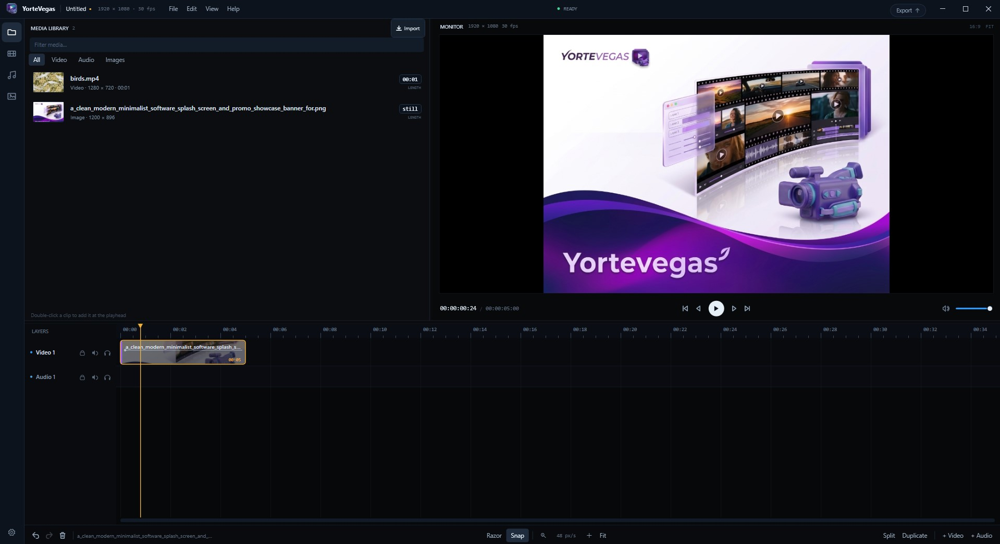

# YorteVegas

A focused desktop video editor for Windows, built with WPF on .NET 8 and powered by mpv.
It is the first editor core of YorteVegas: import media, arrange a timeline, set up
crossfades and clip levels, preview the composited cut, and export a simple MP4.



## What works

- **Media library** — import video, audio and still images with the icon button (or
  `Ctrl+I`); filter by kind with the chips above the list, search, and see durations /
  dimensions. Roomier rows, larger thumbnails and a length badge make the clip length
  visible before you drag it in. Missing files are flagged.
- **Timeline** — video and audio tracks, add/remove/rename layers, mute / solo / lock
  (icons with hover text), drag clips, trim either edge, split at the playhead or with
  the razor tool, duplicate and delete. Video clips show a filmstrip thumbnail, and the
  track stack scrolls vertically when it grows beyond the view.
- **Multi-selection** — `Ctrl`+click adds/removes clips, `Shift`+click selects a run on
  one layer; the selection moves, nudges, changes levels and deletes together.
- **Arranging aids** — the view auto-scrolls while you drag near either edge, `Alt`+`←`/`→`
  nudges the selection by frames, `,` / `.` jump to the previous/next cut, and
  `Shift+Delete` removes a clip and closes the hole. Snapping draws a guide line at the
  edge it locked onto, the ruler gains frame ticks once you zoom in far enough, and `Z`
  frames the selection. Layer menus can close all gaps.
- **Clip operations** — `Ctrl+C` / `Ctrl+V` copy and paste whole clips while keeping
  their relative positions, `Ctrl+A` selects every clip, and `Shift+S` splits every
  layer at the playhead. A clip can be muted from its menu, and dragging its top
  corners sets the fade in/out length (or pick 0.5–3 s from the fade submenu).
- **Library flow** — select several items and press `Enter` (or use "Add to timeline")
  to append them in order, so a batch of videos becomes one sequence in a single step.
  Double-clicking the empty area below the list does nothing.
- **Crossfades** — drag one clip over another to create an overlap. A fade curve is drawn
  over the overlap for video and audio; right-click it to pick Linear, Ease in, Ease out,
  S-curve or Exponential, or to remove the overlap.
- **Clip levels** — drag the horizontal line at the top of a clip to set opacity (video
  and images) or volume (audio). Hover the line to see the exact percentage.
- **Crop, pan and position** — the small icon in a clip's top-right corner (or the clip
  menu) opens a dialog with a **Crop** tab and a **Position** tab. The Position tab can
  shrink the clip and snap it to a corner or the centre; by default it fills the frame
  (letterboxed when the source aspect differs from the project).
- **Effects** — the `fx` button in the left rail opens an effects browser in the media
  library's place. Pick one of **Color Balance**, **Brightness & Contrast**, **Blur**,
  **Gaussian Blur**, **Sharpen**, **Film Grain**, **Glow**, **Chroma Keyer**, **Crop** or
  **Vignette**, then click a preset thumbnail (rendered on `Assets/sample2.png`) to apply
  it, or drag the thumbnail straight onto a clip. Every effect keeps editable sliders
  (with coloured gradients for the colour controls), an enable/bypass switch and a `✕`
  to remove it. **Crop** writes the clip's Crop/Pan box (halves, quarters or a custom
  rectangle); **Vignette** darkens the corners for an old-film look; **Chroma Keyer** keys
  green or blue in both the monitor and the export. Effects are saved in the project.
- **Transitions** — the `⇄` button in the left rail opens a transition browser. Pick
  **Dissolve**, **Flash**, **Cross Effect**, **Slide**, **Push**, **Wipe** or **Iris**,
  then drag a preset onto a crossfade (the overlap of two clips) or onto the left/right
  half of a clip for a start/end transition. Clicking a preset applies it to the selected
  clip edge instead. Every transition has a duration, direction or soft-edge slider and
  an ON/OFF switch; `✕` removes it. Transitions render in the monitor and the export and
  are saved in the project.
- **Editing aids** — snapping to clip edges and the playhead, frame-accurate stepping,
  zoom (mouse wheel, pointer-anchored; `+` / `-`), horizontal scrolling (`Shift` + wheel),
  vertical scrolling (`Alt` + wheel or the right scrollbar), ruler scrubbing that updates
  the monitor live, trimming that previews the edge frame while you drag, and a follow
  playhead during playback.
- **Preview** — mpv renders the clip under the playhead with audio, including still-image
  clips. Transport controls, timecode, volume and frame stepping live below the video.
  If an export range is marked and playback starts inside it, the monitor loops that
  range until you pause.
- **Export range** — drag on empty timeline space (or drag the strip above the ruler,
  or double-click a clip) to mark the segment to export. The strip at the top shows the
  range and its handles; double-click the strip to clear it. The rest of the timeline is
  dimmed, and Export renders only the selected range.
- **Export** — a deliberately basic export page with three choices: **Great**, **Good**
  and **Light for WhatsApp**. No resolution/bitrate controls; just pick one, choose a
  file and render an MP4. While rendering it shows FFmpeg's real progress (percent,
  elapsed/total time and speed), and when it finishes it offers to open the folder.
- **Undo / redo** — snapshot based, including selection, tracks and library changes.
- **Projects** — save/open `.yveg` JSON projects; media stays outside the project file
  (relative paths when possible). Unsaved changes are protected on close, an autosave is
  written every minute and offered for recovery after a crash, and each save keeps the
  previous file as `.bak`.
- **Relinking** — if media moves, right-click it in the library (or use "Locate file…"
  in the monitor) to point the asset at the new file; every clip keeps working.
- **Settings** — defaults for new projects, preview volume, still-image duration and
  "reopen last project".

## Requirements

- Windows 10/11, x64.
- .NET 8 SDK (tested with 8.0.416).
- No separate FFmpeg or mpv installation is needed for playback: the
  `Nickvision.MPVSharp.Bundled` package copies `libmpv-2.dll` next to the app.
- **Export requires FFmpeg.** The app looks for `ffmpeg.exe` beside the executable, in
  a `tools` folder, on `PATH`, or in `%LocalAppData%\YorteVegas`. If it can’t find one,
  the first export asks you to locate it once and remembers the path.

## Build and run

```powershell
dotnet build
dotnet run
```

or launch the built app:

```powershell
.\bin\Debug\net8.0-windows\YorteVegas.exe
```

You can also open files from the command line:

```powershell
YorteVegas.exe "D:\edits\holiday.yveg"      # open a project
YorteVegas.exe "D:\media\b-roll.mp4"         # open the last project and import media
```

## Using the editor

1. **Import** media (`Ctrl+I` or the button in the library). You can also drop files
   onto the library or pass them on the command line.
2. **Add to the timeline** by double-clicking a library item, using its context menu,
   or dragging it onto the timeline. Select several items (`Ctrl`/`Shift`+click) and
   press `Enter` to append them all in list order. Clips are inserted at the playhead
   when there is room and otherwise after the existing clips on the target track.
3. **Edit**: click to select, drag the middle to move, drag either edge to trim. Use
   `Ctrl`/`Shift`+click to build a selection, drag any selected clip to move the group,
   `Alt`+arrows to nudge, `,` / `.` to jump between cuts. `S` (or the Razor toggle)
   splits, `Ctrl+D` duplicates, `Delete` removes, `Shift+Delete` removes and closes the
   gap. Dragging near the timeline edge scrolls it, so long sequences move in one go.
4. **Fade**: drag a clip over the previous clip on the same track to create an overlap,
   then right-click the overlap (its curves/shadows) to choose a curve or remove it.
5. **Levels**: drag the thin horizontal line near the top of a clip down/up. It controls
   opacity for video/images and volume for audio; the tooltip shows the value.
6. **Layers**: right-click a layer header to rename it or remove it. If it contains
   clips, a warning asks for confirmation first; removing a layer is undoable.
7. **Preview** with `Space`; scrub with the ruler. Images use a still duration
   (default 5 s, configurable in Settings).
8. **Export** from the title-bar button, File → Export video… or `Ctrl+E`. Pick
   **Great**, **Good** or **Light for WhatsApp**, choose the file, and press Export.

The small icon in a clip's top-right corner (or the clip menu's **Crop && pan…**) opens
**Crop, pan and position**. The **Crop** tab chooses the visible source area; the
**Position** tab scales the clip and snaps it to a corner or the centre.

## Export

The export page intentionally has no quality knobs. It offers three choices:

| Choice | What it is |
| --- | --- |
| **Great** | Best quality at the full project resolution. |
| **Good** | Up to 1080p; a balanced size for everyday sharing. |
| **Light for WhatsApp** | Up to 720p; a smaller file that sends easily. |

Export writes an H.264/AAC MP4 and is optimized with `faststart`. It renders the
timeline the way the monitor shows it: every video layer with its opacity, the
crossfades between overlapping clips, and all audible clips mixed with their
volumes. Overlap fades are exported as linear ramps even if another curve is
selected in the timeline. If an export range is marked, only that segment is
rendered (the graph is rebased so a short range does not render the whole timeline).

### Stretching clips

- **Drag the right edge** to trim. Dragging past the end of the source repeats the
  media; dashed lines mark where it loops back.
- Dragging back towards one full pass **snaps to the regular length** of the media.
- **Ctrl + drag the right edge** to time-stretch: the clip gets longer/shorter while
  the source stays one pass, so playback becomes slow/fast motion. The clip shows a
  speed badge such as `0.5x`; dragging back near the source length snaps to `1x`.
- Looped playback uses mpv's A-B loop and keeps audio pitch corrected.

### Keyboard shortcuts

| Action | Shortcut |
| --- | --- |
| Play / pause | `Space` |
| Step one frame | `←` / `→` (add `Shift` for one second) |
| Start / end | `Home` / `End` |
| Previous / next cut | `,` / `.` |
| Set export range | Drag empty timeline space or the top strip; double-click a clip |
| Clear export range | Double-click the top strip |
| Nudge selection | `Alt` + `←` / `→` (add `Shift` for one second) |
| Split at playhead | `S` |
| Split all layers | `Shift+S` |
| Select all clips | `Ctrl+A` |
| Copy / paste clips | `Ctrl+C` / `Ctrl+V` |
| Zoom to selection | `Z` |
| Duplicate clip | `Ctrl+D` |
| Delete clip | `Delete` |
| Delete and close gap | `Shift+Delete` |
| Set fade length | Drag the top corner of a clip |
| Add / remove from selection | `Ctrl` + click |
| Select a run on one layer | `Shift` + click |
| Add selected library items | `Enter` (library focused) |
| Undo / redo | `Ctrl+Z` / `Ctrl+Y` |
| Import media | `Ctrl+I` |
| Export video | `Ctrl+E` |
| New / open / save | `Ctrl+N` / `Ctrl+O` / `Ctrl+S` |
| Save as | `Ctrl+Shift+S` |
| Zoom timeline | Mouse wheel (pointer-anchored), or `+` / `-` |
| Fit timeline | `F` |
| Scroll timeline | `Shift` + mouse wheel |
| Scroll layers | `Alt` + mouse wheel, or the right scrollbar |
| Layer menu | Right-click a layer header (rename / remove) |
| Loop / stretch a clip | Drag the right edge; use `Ctrl` + drag for slow/fast motion |
| Change opacity / volume | Drag the line near the top of a clip |
| Razor tool | Razor toggle in the bottom strip |

## Project format

`.yveg` files are readable JSON (version 1). They hold project settings, the media
library, tracks and clips. Media is always referenced by path, never embedded; paths
inside the project folder are stored relatively so a folder can be moved as a unit.

```text
%AppData%\YorteVegas\settings.json   user preferences
%AppData%\YorteVegas\autosave\       crash-recovery copy of the open edit
%AppData%\YorteVegas\crash.log       written if an unexpected error occurs
<app folder>\mpv.log                 mpv initialization diagnostics
```

## Preview model and known limits

- The monitor **composites every active layer**: one libmpv render context per clip,
  bottom track first, blended with clip opacity and the overlap fade curve. Audio from
  all audible layers is mixed. Layers render at 540p to keep playback smooth.
- Looped and time-stretched playback uses mpv's A-B loop/speed with a wall-clock
  playhead anchor, so it is a preview approximation rather than a rendered result.
- Audio-only clips show an "Audio only" monitor panel while the soundtrack continues.
- Track mute / solo affect preview audio.
- Export mirrors the compositor: every video layer bottom to top with clip opacity,
  an alpha fade for each overlap, and all audible clips delayed, volume-adjusted and
  mixed through a limiter. Overlap fades export as linear ramps even when another
  curve is selected. Export requires FFmpeg.
- No effects, titles or color tools in this build.
- Video filmstrips use the Windows thumbnail for the file, repeated along the clip
  (not multiple sampled frames).
- Timecode uses drop-frame notation (`;` before frames) for 29.97/59.94 and non-drop
  for other rates.
- Fade duration is the overlap itself; drag either clip to lengthen or shorten the
  crossfade. The curve shape is editable separately.

## Architecture

```text
MainWindow.xaml / .cs          Shell, workspace, library, monitor, transport, shortcuts
Controls/PreviewCompositor.cs  HwndHost + OpenGL layer compositor
Controls/PositionEditor.cs     Drag/scale placement inside the crop/pan dialog
Controls/TimelineView.cs       Custom-drawn timeline, hit-testing and editing gestures
ViewModels/EditProject.cs    Media, tracks, clips, selection, playhead, edit operations
Services/TimelinePreview.cs  Layer loading, seeking, playback state machine
Services/MediaProbeService.cs  Duration/size probing and Shell video thumbnails
Services/ExportService.cs    FFmpeg MP4 export (all layers, fades and mixed audio)
Services/ProjectService.cs   .yveg DTOs, save/load, undo snapshots
Services/AutosaveService.cs  Periodic recovery copy of the open edit
Services/UndoService.cs      Bounded snapshot undo/redo
Dialogs/                     New project, settings, dark message dialog
Themes/Dark.xaml             Shared dark-blue palette and control styles
Models/                      Observable project model
```

The UI is plain WPF code-behind (no MVVM framework), matching the YorteImpact
foundation. Timeline mutations go through `EditProject`, which raises
`TimelineChanged` and supports undo snapshots. The preview is driven by
`TimelinePreview`, which owns the playback state machine and never touches WPF
controls from mpv callbacks.
